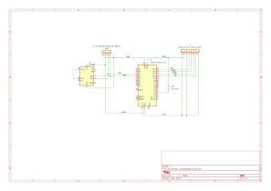

# LiFePO4 Battery Monitor

Arduino Nano prototype for monitoring two parallel 12.8 V, 8 Ah LiFePO4 batteries.
The [root README](../README.md) contains the current capabilities, component list,
limitations and build/upload instructions. Firmware is in
[`src/firmware/`](../src/firmware/).

## Hardware and power

The prototype uses an INA228 breakout, SH1106 I²C OLED and a momentary button
between D3 and ground. The Nano's internal pull-up is enabled. I²C uses A4/SDA
and A5/SCL. Firmware assumes a 0.015 Ω shunt, a 10 A calibration range and 16 Ah
nominal capacity; verify these assumptions against the actual hardware.

The documented prototype supply arrangement is:

```text
LiFePO4 pack
    ├── INA228 voltage/current measurement
    └── 5 V buck converter ──> Arduino Nano
                                  └── 3.3 V rail ──> INA228 + OLED
```

All connected circuits need a common ground. Verify the Nano's available 3.3 V
current, module supply requirements, I²C pull-up voltages and signal compatibility.
This supply diagram is a prototype note, not a validated wiring specification.
The schematic includes an SPI FRAM header; firmware persistence and final module
power/signal wiring documentation are still planned.

## Schematics

Open the [KiCad 9 project](hardware/schematic_breadboard/schematic_breadboard.kicad_pro)
or [schematic](hardware/schematic_breadboard/schematic_breadboard.kicad_sch).
All used symbols are embedded. The PCB file is empty, not a routed design.
The [SVG export](docs/schematic_breadboard.svg) is retained for review.



## Capacity estimate

Current is integrated using successive samples and elapsed time. Positive current
adds to amp-hours used; negative current subtracts. Used capacity is clamped to
0–16 Ah. Remaining capacity is 16 Ah minus used capacity. Every boot starts at
an assumed 100%, with no saved history or reset control. Runtime estimates are
not currently output. Accuracy depends on calibration, starting charge,
uninterrupted current observation, temperature, battery age and load.

## Safety and licence

This is an **experimental hobby electronics project**, **not a certified Battery
Management System (BMS)**. It **must not be relied upon for battery protection**.
Appropriate fusing and independent battery protection are required. Disconnect
the battery before changing wiring and use conductors rated for the fault and
operating currents.

See the [MIT licence](../LICENSE), [third-party notices](../THIRD_PARTY_NOTICES.md)
and [contribution guidelines](../CONTRIBUTING.md).
